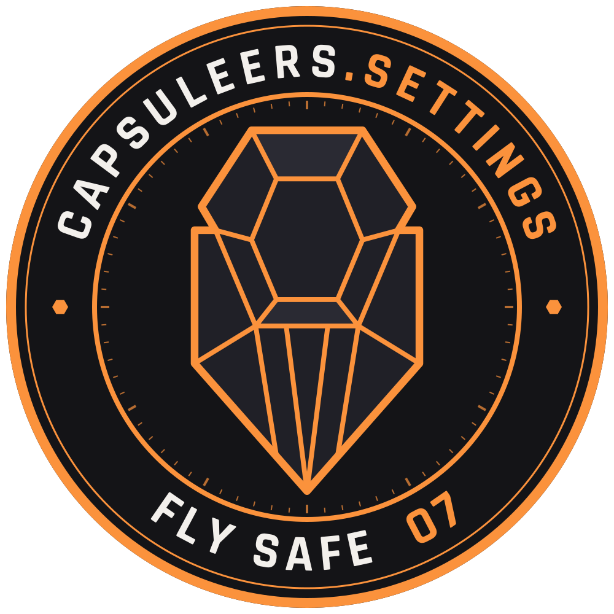
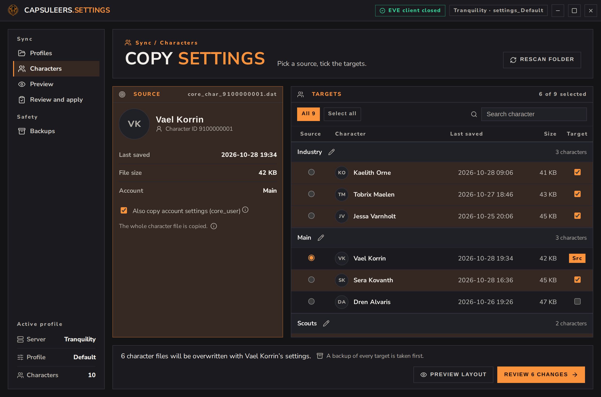
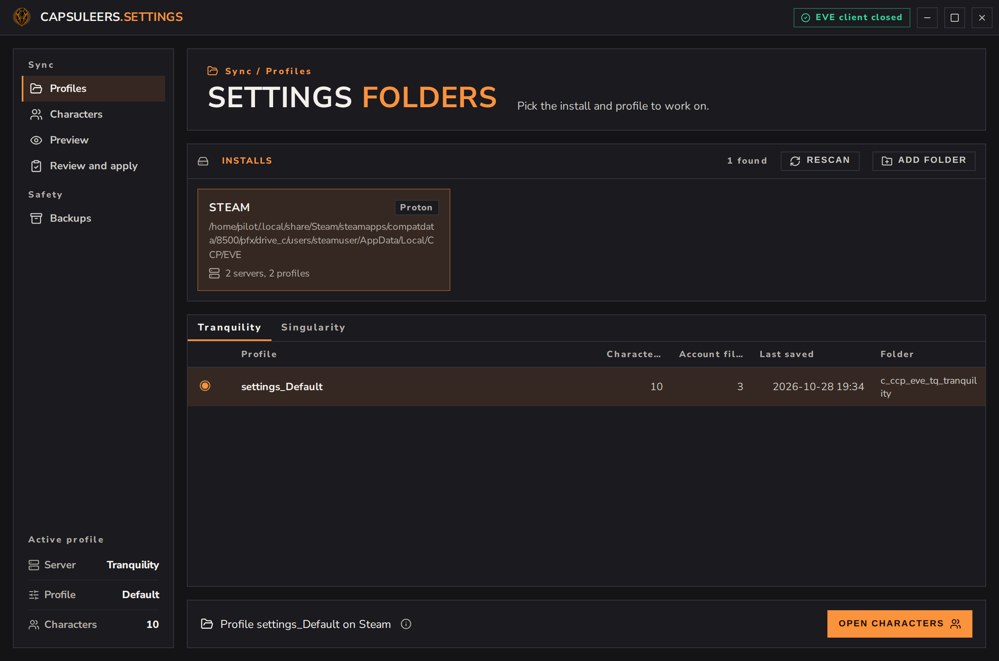
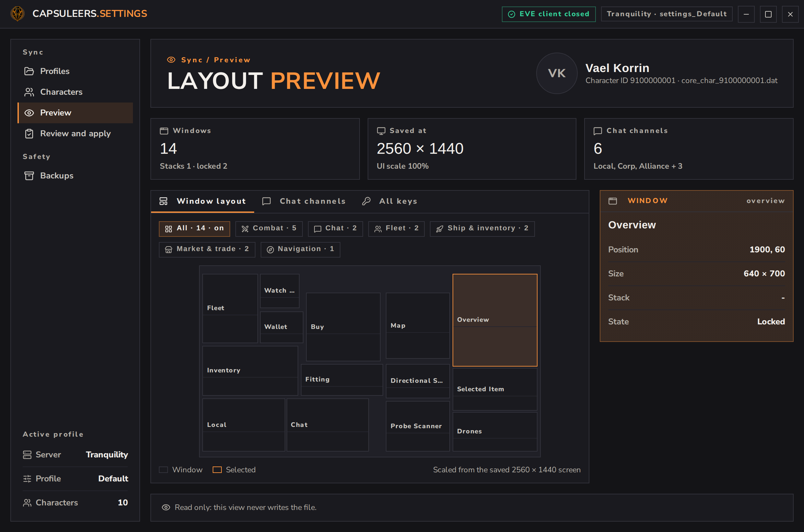
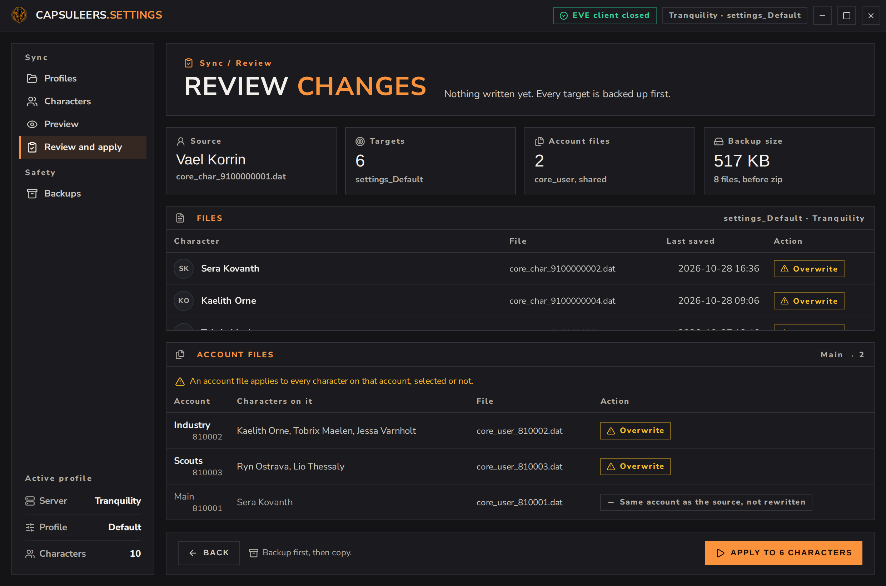
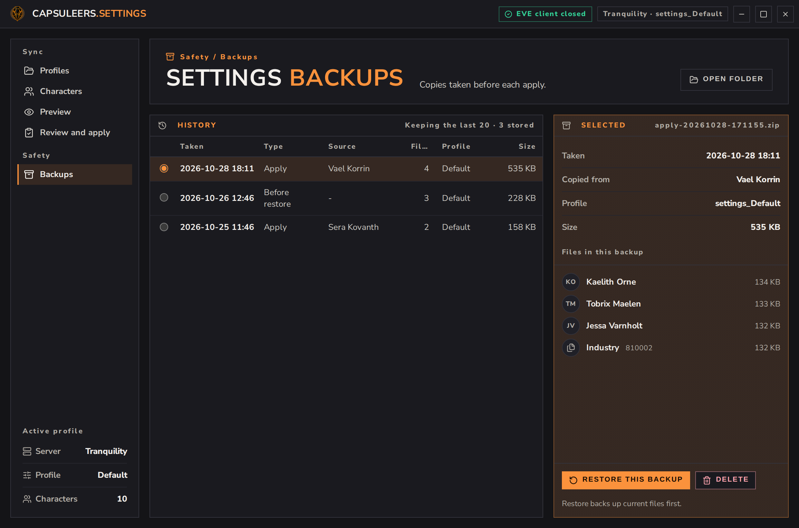
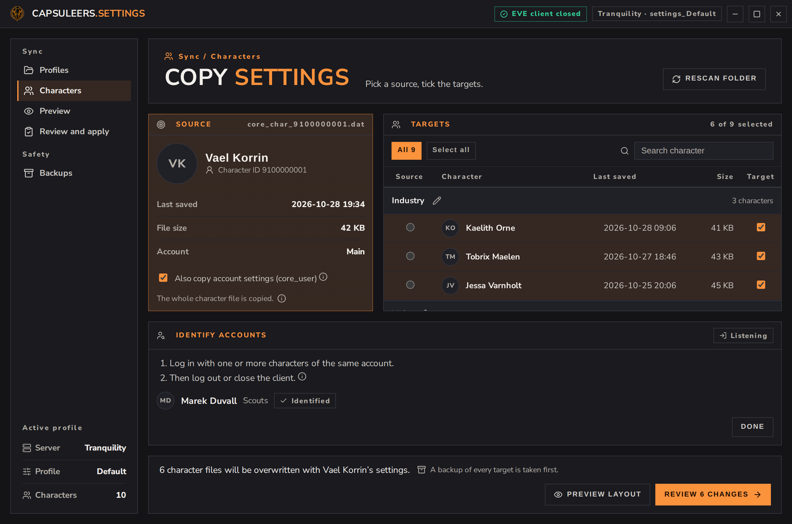

<p align="center"></p>

# Capsuleers.Settings

**Capsuleers.Settings** — a **standalone, cross-platform** desktop tool for **EVE Online** that
**copies your client settings** (window layout, chat channels, overview, shortcuts) **from one
character to many**, safely. Set up one character the way you like it, then apply it to the rest
of your alts in a few clicks.

It belongs to the [**Capsuleers**](https://capsuleers.app) family, next to
[**Capsuleers.Intel**](https://github.com/capsuleers-app/capsuleers.intel): same look, a small
single binary, nothing to set up on first launch.

## Screenshots

<p align="center"></p>

All characters and accounts shown are invented demo data.

| | |
|---|---|
| <br>**Profiles** — installs, servers and settings folders | <br>**Layout preview** — a read-only map of the source's windows |
| <br>**Review** — every file to overwrite, account files included | <br>**Backups** — restore any of the last 20 |
| <br>**Identify** — link characters to their account | |

## Features

- **Finds your settings** — Windows, macOS and Linux (Steam / Proton, Flatpak Steam, extra Steam
  libraries). Add any folder by hand. Tranquility comes first and is preselected.
- **One source, many targets** — pick a profile, a source character and the targets; review, then
  apply. The last source you picked is remembered per profile.
- **Account settings too** — EVE keeps overview, shortcuts and UI preferences per **account**
  (`core_user`), so characters are **grouped by account**. The link comes only from certain
  evidence: the EVE launcher logs, files the client wrote, or **IDENTIFY** (log characters in and
  out while the app watches the file times, read-only). Characters with no certain account stay
  under "To identify" and are never used for an account copy. Each account file is written once.
- **Layout preview** — a read-only map of the source's windows, filterable by type (combat, chat,
  fleet, ship, market, navigation), decoded from the settings file itself.
- **Backups & restore** — every target is zipped first, copies are atomic, and any of the last 20
  backups can be restored (the restore backs up the current files too).
- **Client guard** — refuses to write while an EVE client is running, since the client would
  overwrite your change when it exits.
- **Names & portraits** — character names from ESI (no login, cached) and portraits from
  images.evetech.net; works offline with IDs.
- **English and Italian** from the system locale.

Nothing is written until you press **Apply**, and never outside the chosen `settings_*` folder.

## Privacy & security

No account, no login, no telemetry. The only network calls are ESI `universe/names` (with a fixed
`User-Agent`) and portrait images. The UI is served from the binary with a strict
**Content-Security-Policy** (`frontend/index.html`): scripts and connections to `'self'` only,
images also from images.evetech.net, local fonts and assets, no CDN.

The EVE launcher logs also contain login tokens: the app reads **only** the account and character
IDs from them and never stores, logs or shows anything else. Report issues per
[`SECURITY.md`](SECURITY.md).

## Run from source

Requires Go 1.26+, Node.js and [Wails v3](https://v3.wails.io). On Linux you also need the GTK3
and webkit2gtk-4.1 development headers.

```bash
cd frontend && npm install && npm run build && cd ..
go run -tags gtk3 .           # Linux (Wails v3 defaults to GTK4: always pass gtk3)
go run .                      # Windows / macOS
go test ./internal/...
```

Regenerate the frontend bindings after editing `service.go`:
`wails3 generate bindings -ts -f "-tags gtk3"`.

## Build

```bash
go build -tags "gtk3 production" -ldflags "-s -w" -o bin/capsuleers.settings .
GOOS=windows CGO_ENABLED=0 go build -tags production -ldflags "-s -w -H windowsgui" -o bin/capsuleers.settings.exe .
```

The Windows icon and manifest come from `rsrc_windows_amd64.syso` (`build/windows/`). On Linux the
app installs its own `.desktop` entry and icon under `~/.local/share` at startup, so Wayland
taskbars show the right icon.

### Continuous build & auto-release (GitHub Actions)

[`.github/workflows/build.yml`](.github/workflows/build.yml) runs automatically on **every push /
merge to `main`**: `go vet` + tests, then the Linux and Windows binaries on their native runners,
then a **GitHub Release** with both binaries attached.

The release version is `<major>.<minor>.<run-number>` from `frontend/package.json` (e.g. `0.1.0`
→ `v0.1.42` on run #42), stamped into the binary at build time, without committing a version bump
back to the repo. To start a new minor/major line, bump `major`/`minor` in
`frontend/package.json` and push to `main`.

No secrets to configure: the workflow uses the built-in `GITHUB_TOKEN`. Dependabot keeps Go, npm
and Actions dependencies up to date ([`.github/dependabot.yml`](.github/dependabot.yml)).

## Architecture

Go + Wails v3 app, entry point [`main.go`](main.go); Vue 3 + TypeScript UI in
[`frontend/`](frontend/), embedded in the binary. No server, no database.

| Module | Role |
|---|---|
| [`service.go`](service.go) | The API the UI calls (discovery, characters, accounts, preview, apply, backups). |
| [`identify.go`](identify.go) | Guided IDENTIFY: polls file times and pairs each saved `core_char` with the `core_user` saved with it. |
| [`internal/eve`](internal/eve) | Finds installs, servers and `settings_*` profiles; detects a running client. |
| [`internal/accounts`](internal/accounts) | Character → account links from launcher logs, client files and IDENTIFY; copy plan per account. |
| [`internal/backup`](internal/backup) | Zip backup with manifest, atomic copy, restore and pruning. |
| [`internal/marshal`](internal/marshal) | Read-only decoder for CCP's `blue.marshal` settings format. |
| [`internal/charsettings`](internal/charsettings) | Read-only summary of a character file (window layout, channels) for the preview. |
| [`internal/esi`](internal/esi) | ESI name lookup; single source of `User-Agent` and app version. |
| [`internal/config`](internal/config) | Extra folders, learned account links, aliases, last source. |

See [CONTRIBUTING.md](CONTRIBUTING.md) for the dev flow and [CLAUDE.md](CLAUDE.md) for an
architecture brief.

## Disclaimer

> EVE Online and the EVE logo are the registered trademarks of Fenris Creations. All rights
> are reserved worldwide. All other trademarks are the property of their respective
> owners. EVE Online, the EVE logo, EVE and all associated logos and designs are
> the intellectual property of Fenris Creations. All artwork, screenshots, characters,
> vehicles, storylines, world facts or other recognizable features of the
> intellectual property relating to these trademarks are likewise the intellectual
> property of Fenris Creations.
>
> Fenris Creations has granted permission to Capsuleers.Settings to use EVE Online and all
> associated logos and designs for promotional and information purposes on its
> website but does not endorse, and is in no way affiliated with,
> Capsuleers.Settings. Fenris Creations is in no way responsible for the content on or
> functioning of this software, nor can it be liable for any damage arising from the
> use of this software.

**Unofficial tool** made by fans. Source code is MIT (see [LICENSE](LICENSE)); full
attributions and third-party notices in [THIRD_PARTY.md](THIRD_PARTY.md). Keep a copy of your
settings and always check in-game.
